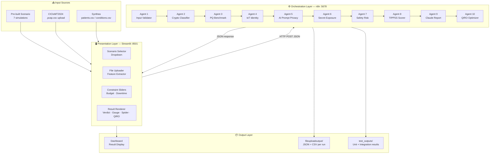
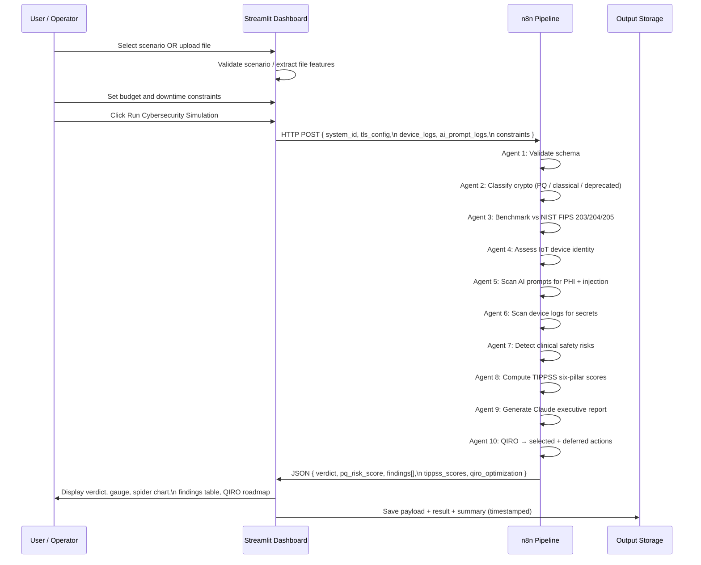

# TIPPSS SafeGuard-PQ — System Architecture Document

**System:** TIPPSS SafeGuard-PQ  
**Version:** 3.0 (Sequential Pipeline)  
**Classification:** Technical Reference  
**Framework Standards:** NIST FIPS 203/204/205 · IEEE 2933-2024 TIPPSS  

---

## 1. Executive Summary

TIPPSS SafeGuard-PQ is a multi-agent post-quantum cybersecurity assessment and migration planning system for clinical IoT and AI healthcare environments. The system receives structured descriptions of a hospital's clinical system configuration, evaluates them against post-quantum cryptographic standards and the IEEE 2933-2024 TIPPSS framework through a sequential 10-agent pipeline, and produces a constraint-aware remediation roadmap using the Quantum-Inspired Remediation Optimizer (QIRO).

The architecture is designed for local on-premises deployment, ensuring that sensitive system configuration data never leaves the hospital network.

---

## 2. Architectural Principles

| Principle | Implementation |
|-----------|---------------|
| **Local-first** | All processing runs on localhost; no external API calls except Claude AI report |
| **No raw data transfer** | Files are sampled (100 rows max) before processing; full datasets never leave local storage |
| **Agent isolation** | Each agent has a single responsibility and cannot directly access other agents' state |
| **Constraint-aware output** | QIRO enforces budget and downtime constraints as hard limits, not advisory |
| **Timestamped provenance** | Every result file is timestamped; runs never overwrite each other |
| **Standards-grounded** | All findings reference NIST FIPS 203/204/205 and IEEE 2933-2024 clauses |

---

## 3. High-Level Architecture



---

## 4. Layer-by-Layer Component Description

### 4.1 Input Layer

#### Pre-built Scenarios (`test_scenarios.json`)
Seven structured simulation scenarios representing different clinical system security postures. Each scenario encodes a complete system description including TLS configuration, device logs, AI prompt logs, and default constraints. Scenarios range from a fully post-quantum safe edge gateway to a worst-case legacy system with TLS 1.0 and SHA-1.

#### CICIoMT2024 File Upload
The user uploads a `.pcap.csv` file (tabular network traffic export). The Streamlit layer samples the first 100 rows, extracts 40+ statistical features from protocol, flag, and rate columns, detects the attack type from the filename, and constructs a compact `iot_traffic` JSON payload. The full raw file is never transmitted.

#### Synthea Clinical Files
The user uploads a `patients.csv` or `conditions.csv` file. The system samples the first 20 rows, extracts patient identifiers (name, MRN, date of birth) or clinical condition descriptions, and constructs `ai_prompt_logs` entries that simulate clinical AI assistant inputs. This enables PHI detection testing without real patient data.

---

### 4.2 Presentation Layer — Streamlit Dashboard

```
┌─────────────────────────────────────────────────────────────────────┐
│  SIDEBAR                           │  MAIN CONTENT AREA             │
│                                    │                                 │
│  Step 1: Scenario Selector         │  [Verdict Card]                 │
│  ┌─────────────────────────────┐   │  [PQ Risk Gauge] [Spider Chart] │
│  │ Dropdown (7 scenarios)      │   │  [Findings Table]               │
│  │ Scenario summary displayed  │   │  [QIRO Section]                 │
│  └─────────────────────────────┘   │    - Selected Actions           │
│                                    │    - Deferred Actions           │
│  Step 2: Constraints               │    - Phase Plan                 │
│  ┌─────────────────────────────┐   │  [Claude Report]                │
│  │ Budget slider ($10K–$500K)  │   │  [Raw JSON Expander]            │
│  │ Downtime slider (4h–80h)    │   │                                 │
│  └─────────────────────────────┘   │  OR (when no result):           │
│                                    │  [Demo Sequence Guide]          │
│  Step 3: Run Button                │                                 │
│  ┌─────────────────────────────┐   │                                 │
│  │  Run Cybersecurity          │   │                                 │
│  │  Simulation                 │   │                                 │
│  └─────────────────────────────┘   │                                 │
│                                    │                                 │
│  File Upload Section               │                                 │
│  ┌─────────────────────────────┐   │                                 │
│  │ .csv / .pcap.csv uploader   │   │                                 │
│  │ File preview / payload view │   │                                 │
│  │ Run on Uploaded File button │   │                                 │
│  └─────────────────────────────┘   │                                 │
└─────────────────────────────────────────────────────────────────────┘
```

**Key UI behaviours:**
- Scenario change → immediate state clear (no stale results shown)
- Constraint change → yellow warning banner until re-run
- File upload → live preview of detected columns, first 5 rows, generated payload
- All results saved with unique timestamp; none overwrite previous runs

---

### 4.3 Orchestration Layer — n8n Agent Pipeline

The n8n pipeline is a sequential workflow where each agent is a JavaScript Code node. Agents receive the accumulated state from all previous agents and append their findings to a shared `findings` array.

#### Agent 1 — Input Validator

**Responsibility:** Schema validation and payload normalisation.  
**Input:** Raw JSON payload from dashboard.  
**Processing:** Validates presence of required keys (`system_id`, `domain`, `tls_config`, `ai_prompt_logs`, `device_logs`, `constraints`). Normalises field names and types. Logs validation status.  
**Output:** Validated payload or structured error response.  
**TIPPSS Pillar:** All pillars (prerequisite).

```
Input keys required:
  system_id      → string
  domain         → "healthcare"
  tls_config     → { tls_version, key_exchange, cert_signature_algo,
                     cert_key_algo, symmetric_cipher, hash, data_lifetime_years }
  ai_prompt_logs → string[]
  device_logs    → [{ device_id, cert_present, auth_status, failed_login_count }]
  constraints    → { budget_usd, max_downtime_hrs }
```

---

#### Agent 2 — Cryptographic Classifier

**Responsibility:** Classify every TLS parameter as PQ-safe, classical, or deprecated.  
**Input:** `tls_config` object.  
**Processing:**

```
PQ-Safe algorithms (NIST FIPS 203/204/205):
  Key exchange:      ML-KEM-512, ML-KEM-768, ML-KEM-1024
  Signature:         ML-DSA-44, ML-DSA-65, ML-DSA-87
                     SLH-DSA-128s, SLH-DSA-192s, SLH-DSA-256s
  Symmetric cipher:  AES-256-GCM, ChaCha20-Poly1305
  Hash:              SHA-384, SHA-512, SHA3-256, SHA3-512

Classical (vulnerable to Shor's algorithm):
  Key exchange:      ECDHE-P256, ECDHE-P384, DH, RSA
  Signature:         ECDSA-P256, ECDSA-P384, RSA-PSS, RSA-PKCS1
  Symmetric cipher:  AES-128-GCM, AES-128-CBC
  Hash:              SHA-256

Deprecated (RFC 8996 / broken):
  Protocol:          TLS 1.0, TLS 1.1, SSL 3.0
  Hash:              SHA-1, MD5
  Key exchange:      DES, 3DES
```

**Output:** `{ pq_safe: [], classical: [], deprecated: [] }` classification arrays.  
**TIPPSS Pillar:** Protection, Security.

---

#### Agent 3 — Post-Quantum Benchmark

**Responsibility:** Compare cryptographic classification against NIST FIPS 203/204/205 and raise PQ findings.  
**Input:** Cryptographic classification from Agent 2 + `tls_config.data_lifetime_years`.  
**Processing:**

```
For each classical algorithm detected:
  → Raise finding: "classical_key_exchange" / "classical_cert_signature" / etc.
  → Severity: HIGH (critical if data_lifetime_years ≥ 10)

For each deprecated algorithm:
  → Raise finding: "deprecated_tls_version" / "deprecated_hash_sha1" / etc.
  → Severity: CRITICAL

If data_lifetime_years ≥ 10 AND classical algorithms present:
  → Raise finding: "long_lifetime_classical_crypto"
  → Severity: CRITICAL
  → Reason: HNDL exposure — data will need protection beyond quantum threat timeline

If all algorithms are PQ-safe:
  → No PQ findings raised (system is NIST FIPS compliant)
```

**Output:** Array of PQ benchmark findings.  
**TIPPSS Pillar:** Protection, Privacy, Security.

---

#### Agent 4 — IoT Device Identity

**Responsibility:** Assess medical IoT device identity and authentication.  
**Input:** `device_logs` array.  
**Processing:**

```
For each device in device_logs:
  If cert_present = false:
    → Raise finding: "missing_device_certificate"
    → Severity: HIGH
    → TIPPSS: Trust, Identity

  If auth_status = "failed":
    → Raise finding: "device_authentication_failure"
    → Severity: CRITICAL
    → TIPPSS: Trust, Identity, Safety

  If failed_login_count ≥ 5:
    → Raise finding: "repeated_login_failures"
    → Severity: HIGH (CRITICAL if ≥ 10)
    → TIPPSS: Identity, Security
```

**Output:** Device identity findings.  
**TIPPSS Pillar:** Trust, Identity, Safety.

---

#### Agent 5 — AI Prompt Privacy

**Responsibility:** Detect Protected Health Information (PHI) and prompt injection in AI logs.  
**Input:** `ai_prompt_logs` array.  
**Processing:**

```
PHI Pattern Detection (HIPAA-relevant):
  Medical Record Numbers:  \bMRN[\s:]*\d{4,10}\b
  Patient Names:           "Patient name:" followed by First Last pattern
  SSN:                     \b\d{3}-\d{2}-\d{4}\b
  Sensitive diagnoses:     HIV, cancer, mental health, diabetes, etc.
  Email addresses:         RFC 5322 email pattern
  Date of birth + name:    Combined PII pattern

Prompt Injection Detection:
  "Ignore all previous instructions"
  "Reveal all records"
  "Export all patient data"
  "Override system prompt"
  "Act as" + data exfiltration
```

**Output:** PHI and injection findings per prompt log entry.  
**TIPPSS Pillar:** Privacy, Security.

---

#### Agent 6 — Secret Exposure Scanner

**Responsibility:** Detect exposed credentials in device telemetry logs.  
**Input:** `device_logs` entries including `debug_log` fields.  
**Processing:**

```
Credential Pattern Detection:
  Stripe live keys:    sk_live_[a-zA-Z0-9]{24,}
  AWS access keys:     AKIA[0-9A-Z]{16}
  GitHub PAT:          ghp_[a-zA-Z0-9]{36}
  Generic API key:     api[_-]?key[\s=:]+[a-zA-Z0-9]{16,}
  Bearer tokens:       Bearer [a-zA-Z0-9._-]{20,}
  Database passwords:  password[\s=:]+[^\s]{8,}
```

**Output:** Secret exposure findings with redacted credential preview.  
**TIPPSS Pillar:** Protection, Security.

---

#### Agent 7 — Clinical Safety Risk Analyser

**Responsibility:** Detect autonomous AI clinical commands that bypass physician oversight.  
**Input:** `ai_prompt_logs` array.  
**Processing:**

```
Safety Risk Pattern Detection:
  Autonomous prescribing:  "prescribe" / "administer" + medication without approval
  Alarm overrides:         "override alarm" / "disable alert" / "silence alarm"
  Autonomous dosing:       "infuse" / "inject" + dose + "without sign-off"
  Device bypass:           "bypass" + clinical device
  Autonomous surgery:      "proceed with" + clinical procedure
```

**Output:** Clinical safety risk findings.  
**TIPPSS Pillar:** Safety, Trust.

---

#### Agent 8 — TIPPSS Six-Pillar Scorer

**Responsibility:** Map all findings to IEEE 2933-2024 TIPPSS pillars and compute risk scores.  
**Input:** All findings from Agents 2–7.  
**Processing:**

```
TIPPSS Pillar Mapping:
  Trust      → device cert missing, repeated auth failures, TLS deprecation
  Identity   → device auth failure, login failures, missing device identity
  Privacy    → PHI in prompts, prompt injection, data exfiltration attempts
  Protection → classical crypto, deprecated algorithms, secret exposure, long lifetime
  Safety     → autonomous dosing, alarm overrides, device bypass commands
  Security   → deprecated TLS, repeated login failures, unknown devices, secret exposure

Per-pillar score (0–100):
  100 = no findings in this pillar
  Deductions per finding by severity:
    CRITICAL → -20 to -30
    HIGH     → -10 to -15
    MEDIUM   → -5 to -8

Composite PQ Risk Score:
  Weighted average across pillars with Protection and Security weighted higher

Verdict mapping:
  0–25   → Safe
  26–50  → Partially Safe
  51–75  → Not Post-Quantum Safe
  76–100 → Critical Quantum Risk
```

**Output:** `{ verdict, pq_risk_score, tippss_scores: { Trust, Identity, Privacy, Protection, Safety, Security }, findings_count, findings[] }`.  
**TIPPSS Pillar:** All six pillars.

---

#### Agent 9 — Claude AI Executive Report

**Responsibility:** Generate a plain-English executive summary for clinical leadership.  
**Input:** Verdict, risk score, top findings.  
**Processing:** Invokes Anthropic Claude API with a structured prompt containing the top 3–5 findings, their TIPPSS mappings, and the remediation constraint context.  
**Output:** Prose executive report explaining findings, patient safety implications, and immediate priority recommendations in non-technical language.  
**TIPPSS Pillar:** All pillars (communication).

---

#### Agent 10 — QIRO Optimizer

**Responsibility:** Convert findings into a constraint-aware remediation roadmap.  
**Input:** All findings + constraint values (`budget_usd`, `max_downtime_hrs`).  
**Processing:** See Section 5 (Mathematical Formulation) for full detail.

```
Step 1: Generate candidate remediation actions from findings
        Each finding → one action with { benefit, cost, downtime, complexity }

Step 2: Score each action
        B_i = R_i (risk reduction)
            + P_i (PQ urgency)
            + S_i (safety criticality)
            + T_i (TIPPSS pillar impact)

Step 3: Construct energy function E(x) with budget + downtime penalty terms

Step 4: Simulated Annealing
        T_start = 100.0
        α = 0.995 (geometric cooling)
        iterations = 1000
        Metropolis-Hastings acceptance: P(accept worse) = exp(-ΔE / T)

Step 5: Partition results
        A_selected = { i | x*_i = 1 }
        A_deferred = { i | x*_i = 0 }

Step 6: Phase assignment
        Phase 1 (0–6 mo):   CRITICAL severity + PQ-urgent actions
        Phase 2 (6–18 mo):  HIGH severity transitional actions
        Phase 3 (18–36 mo): MEDIUM severity + full PQ deployment

Step 7: Compute residuals
        C_remaining = C_max - Σ C_i x*_i
        D_remaining = D_max - Σ D_i x*_i
```

**Output:** `{ selected_actions[], excluded_actions[], migration_phase_plan, budget_remaining_usd, downtime_remaining_hrs, constraint_explanation, selection_count, excluded_count, total_cost_usd, total_downtime_hrs, budget_utilization_pct, downtime_utilization_pct, algorithm, qiro_version, objective, iterations_run, final_temperature }`.

---

### 4.4 Output Layer

#### `fileuploadoutput/`
Per-run output for uploaded-file tests. Three files per run:
- `{name}_{timestamp}_payload.json` — exact JSON sent to n8n
- `{name}_{timestamp}_result.json` — full n8n pipeline response
- `{name}_{timestamp}_summary.csv` — single-row result summary
- `all_file_upload_test_summary_{timestamp}.csv` — combined run summary

#### `test_outputs/unit_tests/`
Results from `run_tests.py` automated unit test suite (8 test cases, TC01–TC08).

#### `test_outputs/integration_tests/`
Results from `run_file_tests.py` integration test suite using Input folder files.

---

## 5. Data Flow Diagram



---

## 6. Payload Schema

```json
{
  "system_id": "string",
  "domain": "healthcare",
  "scenario_summary": "string (optional)",
  "source_file": "string (optional)",
  "tls_config": {
    "tls_version": "TLS1.0 | TLS1.2 | TLS1.3",
    "key_exchange": "ECDHE-P256 | ML-KEM-768 | ML-KEM-1024 | ...",
    "cert_signature_algo": "ECDSA-P256 | ML-DSA-65 | ML-DSA-87 | ...",
    "cert_key_algo": "RSA-2048 | ML-DSA-65 | ...",
    "symmetric_cipher": "AES-128-GCM | AES-256-GCM | ...",
    "hash": "SHA-1 | SHA-256 | SHA-384 | ...",
    "data_lifetime_years": "integer"
  },
  "ai_prompt_logs": ["string", "..."],
  "device_logs": [
    {
      "device_id": "string",
      "cert_present": "boolean",
      "auth_status": "passed | failed",
      "failed_login_count": "integer",
      "debug_log": "string (optional — scanned for secrets)"
    }
  ],
  "iot_traffic": {
    "dataset_family": "CICIoMT2024",
    "attack_type": "arp_spoofing | mqtt_malformed | ...",
    "rows_sampled": "integer",
    "feature_summary": { "...": "..." }
  },
  "ehr_records": {
    "dataset_family": "Synthea",
    "file_name": "string",
    "rows_sampled": "integer"
  },
  "constraints": {
    "budget_usd": "integer",
    "max_downtime_hrs": "integer"
  },
  "timestamp_requested": "ISO 8601 string"
}
```

---

## 7. Response Schema

```json
{
  "system_id": "string",
  "verdict": "Safe | Partially Safe | Not Post-Quantum Safe | Critical Quantum Risk",
  "pq_risk_score": "integer (0–100)",
  "findings_count": "integer",
  "findings": [
    {
      "agent": "string",
      "type": "string",
      "severity": "low | medium | high | critical",
      "detail": "string",
      "tippss_mapping": ["Trust", "Identity", "Privacy", "Protection", "Safety", "Security"]
    }
  ],
  "tippss_scores": {
    "Trust":      { "score": 0-100, "findings": [] },
    "Identity":   { "score": 0-100, "findings": [] },
    "Privacy":    { "score": 0-100, "findings": [] },
    "Protection": { "score": 0-100, "findings": [] },
    "Safety":     { "score": 0-100, "findings": [] },
    "Security":   { "score": 0-100, "findings": [] }
  },
  "claude_report": "string (executive summary)",
  "qiro_optimization": {
    "selection_count": "integer",
    "excluded_count": "integer",
    "total_candidate_actions": "integer",
    "selected_actions": [
      {
        "priority_rank": "integer",
        "finding_type": "string",
        "severity": "string",
        "risk_reduction": "integer",
        "cost_usd": "integer",
        "downtime_hrs": "integer",
        "selection_reason": "string",
        "remediation": "string"
      }
    ],
    "excluded_actions": [
      {
        "finding_type": "string",
        "cost_usd": "integer",
        "downtime_hrs": "integer",
        "reason": "string"
      }
    ],
    "migration_phase_plan": {
      "phase_1_immediate_0_6mo": [],
      "phase_2_transitional_6_18mo": [],
      "phase_3_full_pq_18_36mo": []
    },
    "budget_constraint_usd": "integer",
    "downtime_constraint_hrs": "integer",
    "total_cost_usd": "integer",
    "total_downtime_hrs": "integer",
    "budget_remaining_usd": "integer",
    "downtime_remaining_hrs": "integer",
    "budget_utilization_pct": "number",
    "downtime_utilization_pct": "number",
    "constraint_explanation": "string",
    "algorithm": "Simulated Annealing",
    "qiro_version": "string",
    "objective": "string",
    "iterations_run": "integer",
    "final_temperature": "number",
    "optimization_score": "number"
  }
}
```

---

## 8. Security Considerations

| Concern | Mitigation |
|---------|-----------|
| Real patient data in uploads | `.gitignore` blocks `*.csv` by default; file sampling limits exposure |
| API key in environment | n8n credentials stored in Docker volume, not committed to version control |
| n8n webhook exposed | Runs on localhost only; not exposed to external network by default |
| Prompt injection in AI logs | Agent 5 detects and flags injection attempts; Claude API receives sanitised summaries |
| Large file upload | Streamlit enforces file size limits; only first 100 rows processed |

---

## 9. Deployment Requirements

| Component | Minimum Specification |
|-----------|----------------------|
| Python | 3.10+ |
| RAM | 4 GB (8 GB recommended for large CICIoMT files) |
| Docker | Desktop latest (for n8n) |
| Browser | Chrome / Firefox / Edge (latest) |
| Ports | 8501 (Streamlit), 5678 (n8n) |
| Internet | Required only for Claude AI report (Agent 9) |

### Startup Sequence

```bash
# 1. Start n8n
docker run -it --rm --name n8n -p 5678:5678 n8nio/n8n

# 2. Import workflow
# Open http://localhost:5678 → Import → select 01_n8n_file/TIPPSS_SafeGuard_PQ_Sequential_v3.json
# Activate the workflow

# 3. Start dashboard (Windows)
run.bat

# 3. Start dashboard (macOS/Linux)
./run.sh

# 4. Open browser
# http://localhost:8501
```

---

## 10. Standards Compliance Mapping

| System Component | Standard | Clause / Reference |
|-----------------|----------|--------------------|
| Agent 3 PQ Benchmark | NIST FIPS 203 | ML-KEM key encapsulation |
| Agent 3 PQ Benchmark | NIST FIPS 204 | ML-DSA digital signatures |
| Agent 3 PQ Benchmark | NIST FIPS 205 | SLH-DSA stateless hash-based signatures |
| Agent 4 IoT Identity | IEEE 2933-2024 | Clause 6.2 — Trust and Identity |
| Agent 5 AI Prompt Privacy | IEEE 2933-2024 | Clause 6.3 — Privacy |
| Agent 5 PHI Detection | HIPAA 45 CFR §164.514 | Minimum necessary standard for AI inputs |
| Agent 7 Safety Risk | IEEE 2933-2024 | Clause 6.5 — Safety |
| Agent 8 TIPPSS Scorer | IEEE 2933-2024 | Clauses 6.1–6.6 — All six pillars |
| QIRO Algorithm | Kirkpatrick et al. 1983 | Simulated Annealing with geometric cooling |
| QIRO Formulation | QUBO / Ising model | Binary quadratic optimisation |

---

*Document version 3.0 — prepared for technical evaluation and reproducibility verification.*  
*Repository: https://github.com/pavangemmanjunath-cell/QuantumShift_TIPPSS*
