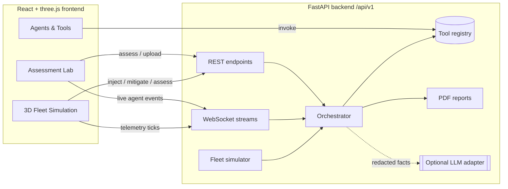
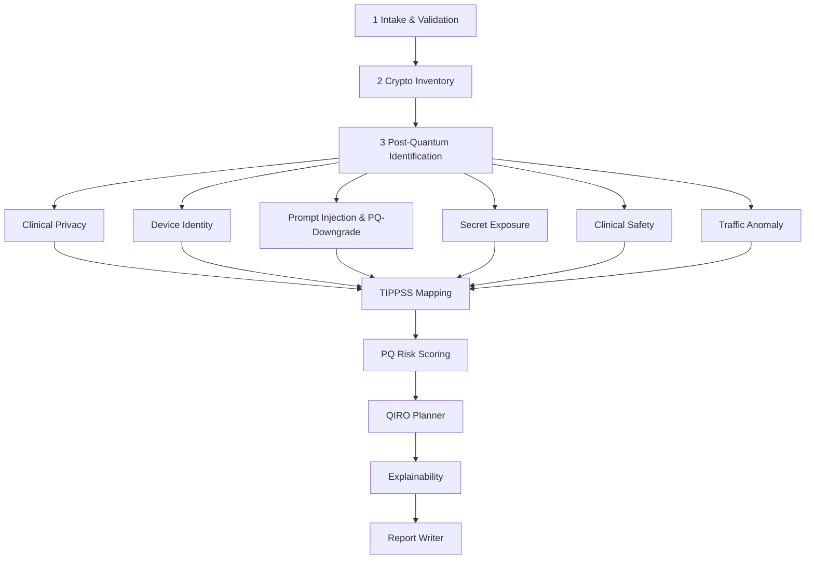

# PostQuantumSafe IoT Cybersecurity · TIPPSS SafeGuard-PQ

**An open, agentic testing framework that checks whether an IoT and edge-device environment is safe against
post-quantum (quantum computer) attacks, explains why, and plans the fixes. It is built on the IEEE 2933-2024
TIPPSS framework (Trust, Identity, Privacy, Protection, Safety, Security) and implemented first for healthcare
(clinical IoT). Research prototype; contributions welcome.**

[](https://github.com/pavangemmanjunath-cell/PostQuantumSafe_IoT_Cybersecurity/actions/workflows/ci.yml)
[](LICENSE)


[](CONTRIBUTING.md)

**Keywords:** post-quantum cryptography · quantum-safe · IoT · edge devices · cybersecurity · agentic testing ·
multi-agent systems · explainable security · NIST FIPS 203/204/205 · IEEE 2933 TIPPSS

> [!TIP]
> **This is a community project.** Anyone can contribute: new device profiles (smart buildings, energy, industrial
> edge), new post-quantum attack simulations, detection rules, dataset adapters, benchmarks, documentation or
> independent reproductions. Start with [CONTRIBUTING.md](CONTRIBUTING.md) and the "Community contributions welcome"
> list in [ROADMAP.md](ROADMAP.md).

> [!IMPORTANT]
> **Research status — early-stage concept.** This repository shares a *thought process* and a working prototype so that
> others can examine, reproduce, criticise and improve it. Detection rules are transparent heuristics, remediation costs
> are illustrative placeholders, and all bundled data is synthetic. It is **not** a certified security assessment, not a
> compliance attestation, and **must not be used for clinical decision-making**.

---

## Contents

[Overview](#overview) · [TIPPSS framework](#built-on-the-tippss-framework) · [Research problem](#research-problem) · [Key contributions](#key-contributions) ·
[How this work differs](#how-this-work-differs) · [Architecture](#system-architecture) · [Methodology](#methodology) ·
[Repository structure](#repository-structure) · [Installation](#installation) · [Quick start](#quick-start) · [Usage](#usage) ·
[LLM integration](#optional-llm-integration) · [Datasets](#datasets) · [Reproducing](#reproducing-the-research) ·
[Benchmarks](#benchmarks) · [Tests](#tests) · [Limitations](#known-limitations) · [Citation](#software-citation) ·
[Contributing](#contributing) · [Releases](#releases) · [Authors](#authors-and-contributors)

## Overview

SafeGuard-PQ is an **agentic testing framework**: 14 cooperating software agents test a connected IoT or edge
environment (an ICU gateway, an infusion pump, a factory PLC, a clinical AI assistant, or a whole simulated fleet) and
decide whether it is quantum safe. Healthcare is the first worked use case; the device profiles and attack catalogue
are designed to be extended to other IoT and edge domains. It answers three questions:

1. **Is the environment safe?** A `SAFE` / `AT_RISK` / `UNSAFE` verdict across the six IEEE 2933-2024 TIPPSS pillars
   (Trust, Identity, Privacy, Protection, Safety, Security), plus a 0–100 post-quantum (PQ) risk score.
2. **Why?** Every finding carries redacted evidence, the rule that fired and a reference; the score is decomposed exactly;
   counterfactuals show what changes if a finding is fixed; every agent's reasoning and tool calls are traced.
3. **What should be fixed first?** *QIRO* selects remediation actions under a budget and a downtime limit and reports
   its gap to the exact optimum where that can be computed.

The system is implemented as **14 cooperating agents** behind a **FastAPI** backend, with a **React + three.js (WebGL)**
interface that shows each agent working live, a 3D IoT fleet simulator with attack injection, and downloadable PDF reports.

**Intended users:** security researchers, students and engineers exploring PQ-migration planning for medical IoT; reviewers
who want to reproduce or challenge the approach.

## Built on the TIPPSS framework

### What TIPPSS is

**TIPPSS** stands for **Trust, Identity, Privacy, Protection, Safety and Security**. It is the security and privacy
framework for connected devices that IEEE standardised for healthcare in **IEEE 2933-2024**, *Standard for Clinical
Internet of Things (IoT) Data and Device Interoperability with TIPPSS*. Its central idea is that a clinical IoT system
is acceptable only when all six properties hold together. Encrypting the network is not enough if a device cannot
prove its identity, if patient data leaks into an AI tool, or if a compromised device can harm a patient.

| Pillar | What it asks in a hospital |
|---|---|
| **Trust** | Can clinicians and other systems rely on the data, the devices and the AI assistant's answers? |
| **Identity** | Is every device, user and service who it claims to be (certificates, authentication)? |
| **Privacy** | Is protected health information (PHI) kept from people and tools that should not see it? |
| **Protection** | Are data and keys protected in transit and at rest, now and against a future quantum computer? |
| **Safety** | Can an attack or an unsafe AI action lead to patient harm (for example a changed infusion dose)? |
| **Security** | Are networks, protocols and software hardened against attack? |

### How this project uses TIPPSS

TIPPSS is the backbone of every assessment, not a label added afterwards. This project adds the **post-quantum view**
to TIPPSS: a quantum computer weakens Protection (harvest-now-decrypt-later), Identity (forged device certificates) and
Trust at the same time, so post-quantum risk is assessed together with the other five concerns instead of in isolation.

1. Every agent that detects a problem tags its finding with the TIPPSS pillars it affects.
2. The **TIPPSS Mapping** agent scores each pillar from 0 to 100 (deductions of 25 / 15 / 8 / 3 points for critical /
   high / medium / low findings) and names the weakest pillar.
3. The **QIRO** planner weights fixes by the pillars they repair, with extra weight on Safety (1.4) and Privacy (1.2)
   because those carry the most direct patient impact in healthcare.
4. The explainability output, the web interface and section 3 of the PDF report show the six pillar scores and which
   findings caused each deduction.

### Where TIPPSS is implemented (healthcare first)

The first and most complete use case is a **hospital / ICU** environment: ICU gateways, infusion pumps, patient
monitors, clinical AI assistants and a simulated ward fleet.

| Pillar | Healthcare check | Agent (`backend/src/safeguard_pq/agents/`) |
|---|---|---|
| Trust | prompt injection and unsafe instructions aimed at a clinical AI assistant | `prompt_injection`, `safety_risk` (`detection.py`) |
| Identity | missing device certificates, failed authentication, quantum-vulnerable certificate signatures | `device_identity` (`detection.py`), `crypto_inventory` (`crypto.py`) |
| Privacy | PHI in prompts and logs; patient data recorded today and decrypted later | `clinical_privacy` (`detection.py`), `pq_identification` (`crypto.py`) |
| Protection | TLS version, key exchange, ciphers and hashes classified against NIST FIPS 203/204/205; exposed secrets | `crypto_inventory`, `pq_identification` (`crypto.py`), `secret_exposure` (`detection.py`) |
| Safety | AI actions that could change therapy or device settings; device spoofing | `safety_risk`, `device_identity` (`detection.py`) |
| Security | network attacks in IoMT traffic (ARP spoofing, DoS/DDoS, port scans, malformed MQTT) | `traffic_anomaly` (`detection.py`) |

| Component | File |
|---|---|
| Pillar list | `backend/src/safeguard_pq/domain/models.py` (`PILLARS`) |
| Pillar mapping of PHI, injection, secret and unsafe-action findings | `backend/src/safeguard_pq/knowledge/patterns.py` |
| Pillar mapping of traffic rules | `backend/src/safeguard_pq/knowledge/traffic_rules.py` |
| Pillar scoring | `backend/src/safeguard_pq/agents/scoring.py` (`tippss_pillars`) and `analysis.py` (TIPPSS Mapping agent) |
| Pillar-weighted remediation | `backend/src/safeguard_pq/optimizer/qiro.py` (`PILLAR_WEIGHTS`) |
| Pillar report section | `backend/src/safeguard_pq/reporting/pdf.py` |

The same pillar model applies to other IoT and edge domains (smart buildings, energy, industrial edge), but those
device profiles are early examples. Healthcare is where the framework is implemented and tested end to end.

> This project uses the TIPPSS pillars from IEEE 2933-2024 as its assessment model. It is an independent research
> prototype: it is not affiliated with or endorsed by IEEE and does not certify conformance with the standard.

## Research problem

Public-key algorithms used across clinical IoT (RSA, ECDH/ECDHE, ECDSA) are breakable by Shor's algorithm on a
cryptographically relevant quantum computer (CRQC). Because health data must stay confidential for many years, traffic
recorded today could be decrypted later (*harvest-now, decrypt-later*). NIST published ML-KEM, ML-DSA and SLH-DSA
(FIPS 203/204/205, 2024), and the NIST IR 8547 *draft* proposes deprecating quantum-vulnerable algorithms after 2030 and
disallowing them after 2035.

Hospitals cannot migrate everything at once: budgets and maintenance windows are limited, and PQ crypto is only one of
several risk dimensions (device identity, PHI leakage into AI tools, unsafe autonomous AI actions, network attacks).
The research question explored here is whether a **transparent, multi-agent pipeline** can (a) identify PQ exposure
together with these other TIPPSS risks, (b) explain its conclusions, and (c) produce a **constraint-aware** migration plan.

## Key contributions

Only capabilities present in this repository are listed.

### Scientific / methodological
- A combined assessment model that maps crypto, identity, privacy, AI-safety, secret-exposure and traffic findings onto the
  IEEE 2933-2024 TIPPSS pillars, with an explicit, additive PQ risk score ([docs/methodology.md](docs/methodology.md)).
- Harvest-now-decrypt-later exposure evaluated from data lifetime and **Mosca's inequality** with user-supplied
  assumptions (reported, not hidden).
- Identification of **PQ-downgrade prompt injection** — instructions that try to make an AI agent weaken PQ protection.

### Algorithmic
- **QIRO**: remediation selection as a two-constraint 0/1 knapsack, solved with simulated annealing (QUBO-style energy)
  plus deterministic local search, with an exhaustive exact solver for small instances to report the optimality gap.
- Transparent traffic-anomaly rules over CICIoMT2024-style flow features (flood, SYN flood, scan, malformed protocol, MITM-like).

### Software
- Python **FastAPI** backend: 14 agents, staged/parallel orchestration, live WebSocket event stream, **tool APIs** the
  agents call (also exposed over HTTP), PDF reports, CSV ingest, provider-agnostic optional LLM.
- **React + three.js** GUI: live agent pipeline, 3D fleet simulation with 14 attack injections and 12 defences,
  explainability views, PDF download.
- IoT fleet simulator (hospital ward and smart-factory templates) with synthetic telemetry or replay of user-downloaded data.

### Reproducibility
- Seeded optimizer and simulator; deterministic finding/action identifiers.
- Regression parity tests against outputs recorded from the earlier JavaScript prototype.
- Benchmark scripts with machine-readable results; 148 backend tests and 10 browser end-to-end tests.

## How this work differs

| Existing approach | Limitation | Approach implemented here | Resulting technical difference |
|---|---|---|---|
| Classical vulnerability scanners | Usually no PQ classification of negotiated primitives | Crypto inventory + PQ identification against FIPS 203/204/205 and NIST IR 8547 (draft) | Each primitive gets a quantum-threat status and a NIST replacement |
| Crypto inventories / CBOM tools | Inventory only; no prioritisation under budget | QIRO constrained selection with stated optimality gap | A phased plan that respects budget and downtime |
| Severity-sorted findings lists | Ignore cost/downtime trade-offs | Benefit model + knapsack optimisation | Different plans for different constraints |
| Black-box ML / LLM risk scoring | Hard to audit | Rule-based agents, exact attributions, counterfactuals, full traces; LLM only rephrases redacted facts | Every number can be traced to an input and a rule |

No claim of superiority is made: no comparative evaluation against other tools has been performed yet
(see [docs/novelty.md](docs/novelty.md)).

## System architecture





Details: [docs/architecture.md](docs/architecture.md).

## Methodology

Input (TLS/crypto configuration, device logs, AI prompt logs, flow features) → normalisation → **detection agents** call
tools (PQ catalogue, PHI/injection/secret/unsafe-instruction scanners, traffic rules) → findings with evidence → TIPPSS
pillar scores and weighted PQ score → QIRO plan → explanations → narrative and PDF.

PQ risk score: `0.30·pkc + 0.20·tls + 0.20·lifetime + 0.15·identity + 0.10·secrets + 0.05·migration`, each category taking
the maximum severity points of its findings (critical 100, high 75, medium 50, low 25). Full formulation, assumptions and
threats to validity: [docs/methodology.md](docs/methodology.md).

## Repository structure

```
.
├── backend/                 FastAPI service and Python package `safeguard_pq`
│   ├── src/safeguard_pq/
│   │   ├── agents/          14 agents + scoring
│   │   ├── orchestrator/    staged, parallel pipeline with live events
│   │   ├── tools/           tool registry (agent-callable APIs)
│   │   ├── knowledge/       PQ catalogue, detection rules, remediation templates, redaction
│   │   ├── optimizer/       QIRO
│   │   ├── simulation/      IoT fleet simulator, attacks, mitigations
│   │   ├── ingest/          CSV adapters (CICIoMT-format, Synthea)
│   │   ├── llm/             optional provider-agnostic LLM adapter
│   │   ├── reporting/       PDF reports
│   │   └── api/             FastAPI app and routes
│   └── tests/               unit + integration (incl. parity fixtures)
├── frontend/                React + TypeScript + three.js (Vite), Playwright E2E tests
├── benchmarks/              benchmark scripts and recorded results
├── datasets/                dataset documentation and synthetic samples
├── docs/                    architecture, methodology, reproducibility, limitations, …
├── examples/                small runnable examples
└── scripts/                 one-command dev launchers
```

## Installation

Requirements: Python ≥ 3.11 (tested with 3.13.5), Node.js ≥ 20 (tested with 24.20.0), npm.

```bash
git clone https://github.com/pavangemmanjunath-cell/PostQuantumSafe_IoT_Cybersecurity.git
cd PostQuantumSafe_IoT_Cybersecurity

# backend
python -m venv backend/.venv
# Windows: backend\.venv\Scripts\activate      Linux/macOS: source backend/.venv/bin/activate
pip install -e "backend[dev]"

# frontend
cd frontend && npm ci && cd ..
```

## Quick start

One command (creates the environments on first run, starts both servers and opens the browser):

```powershell
powershell -ExecutionPolicy Bypass -File scripts\dev.ps1      # Windows
```
```bash
./scripts/dev.sh                                               # Linux / macOS
```

Or manually, in two terminals:

```bash
cd backend && safeguard-pq serve --port 8000          # API docs at http://127.0.0.1:8000/docs
cd frontend && npm run dev                            # GUI at http://127.0.0.1:5173
```

Without the GUI (≈1 s):

```bash
safeguard-pq assess --scenario icu_gateway_critical --pdf report.pdf
# ICU-GW-01: environment UNSAFE | PQ score 61/100 (Not Post-Quantum Safe) | 8 finding(s) | QIRO 5 action(s)
```

## Usage

| Task | How |
|---|---|
| Assess a built-in scenario | GUI → *Assessment Lab*, or `safeguard-pq assess --scenario <id>` (`safeguard-pq scenarios` lists 10) |
| Assess your own system | `POST /api/v1/assessments` with a JSON body (schema at `/docs`), or `safeguard-pq assess --file request.json` |
| Watch agents work live | `WS /api/v1/ws/assessments` — send `{"scenario_id": "..."}` or `{"request": {...}}` |
| Upload a CSV | GUI CSV mode or `POST /api/v1/uploads/assess` (CICIoMT-format flows or Synthea patients/conditions) |
| Simulate a fleet | GUI → *Fleet Simulation*: inject attacks, apply defences, run agents per device or fleet-wide, apply the QIRO plan |
| Download the verdict | `GET /api/v1/assessments/{id}/report.pdf`, `GET /api/v1/simulations/{id}/report.pdf` |
| Call agent tools directly | `GET /api/v1/tools`, `POST /api/v1/tools/{name}` |

Python example: [examples/assess_scenario.py](examples/assess_scenario.py).

### Optional LLM integration

Copy `.env.example` to `.env` and set `LLM_PROVIDER` (`openai_compatible` covers OpenAI, Ollama, vLLM, LM Studio and
other OpenAI-style gateways; `anthropic` uses the Messages API), `LLM_MODEL`, `LLM_BASE_URL`, `LLM_API_KEY`.
The LLM only rewrites the executive narrative from **redacted, aggregated** findings; it never sees raw prompts, logs or
patient data and never changes the verdict, score or plan. On any LLM error the deterministic report is used.

## Datasets

No third-party dataset is redistributed. See [datasets/README.md](datasets/README.md).

| Data | Type | Source / licence | Use |
|---|---|---|---|
| `datasets/samples/*.csv` | Synthetic (generated by this project's simulator) | Apache-2.0 | demos, tests |
| Built-in scenarios | Synthetic, fictional identities | Apache-2.0 | demos, tests |
| CICIoMT2024 | Real lab captures (third party) | Canadian Institute for Cybersecurity — download yourself; cite the dataset paper | rule calibration benchmark, optional replay |
| Synthea | Synthetic EHR (third party) | MITRE, Apache-2.0 — download/generate yourself | PHI-detection demos via upload |

## Reproducing the research

See [docs/reproducibility.md](docs/reproducibility.md). In short:

```bash
cd backend && pytest                                         # 148 tests
cd frontend && npx playwright install chromium && npx playwright test   # 10 browser E2E tests
python benchmarks/qiro_optimality.py --instances 500 --seed 0
python benchmarks/traffic_rules_eval.py --data-dir <CICIoMT2024 test CSV folder>
```

Seeds: optimizer default `QIRO_DEFAULT_SEED=2026` (per-request `seed`), simulator seed per simulation.

## Benchmarks

Recorded on 2026-10-24, software v0.1.0, Python 3.13.5, Windows 11. Raw results in [benchmarks/results/](benchmarks/results/).

**QIRO vs exhaustive optimum** — 500 random synthetic instances (n = 3–14 actions, budgets 20k–100k USD, downtime 4–40 h):

| Method | Instances solved optimally | Mean gap | p95 gap | Max gap |
|---|---|---|---|---|
| Simulated annealing only | 94.8 % | 0.19 % | 0.16 % | 20.16 % |
| Annealing + local search (shipped) | 97.6 % | 0.05 % | 0.00 % | 6.06 % |

**Traffic rules, window level (100 rows)** on the CICIoMT2024 *test* split (user-downloaded; not redistributed):

| File | Windows | Flag rate | Metric |
|---|---|---|---|
| Benign | 376 | 2.7 % | false-positive rate |
| ARP spoofing | 17 | 88.2 % | detection rate |
| MQTT malformed | 17 | 76.5 % | detection rate |
| Recon port scan | 226 | 98.7 % | detection rate |
| TCP DDoS | 1 825 | 95.9 % | detection rate |
| TCP SYN DoS | 985 | 100 % | detection rate |

> These thresholds were chosen by inspecting the same test split, so the numbers are **optimistic** and are not a
> generalisation estimate; ARP and MQTT have only 17 windows each. An independent train/test evaluation is on the roadmap.

## Tests

```bash
cd backend && pytest          # unit: knowledge base, agents, QIRO, scoring, XAI, LLM redaction, ingest, simulator
                              # integration: v0 parity, REST, WebSockets, uploads, PDFs, fleet workflow, CLI
cd frontend && npx playwright test   # real Chromium: GUI flows, 3D scene, live agents, PDF downloads, no console errors
```

## Demo

Run the quick start, open *Fleet Simulation*, select `PUMP-ICU-A12`, inject **SYN flood** and **TLS downgrade**, press
**Run agents** to watch the 14 agents, then apply **Rate limiting** and **PQ-only crypto policy** and run again. Use
**Assess entire fleet → Apply QIRO plan → Fleet PDF** for the fleet-level verdict.

## Known limitations

Rule-based heuristics with false positives/negatives; illustrative costs; synthetic data only; optimistic traffic-rule
numbers; no real network/TLS scanning (configuration is supplied as input); the TIPPSS scoring weights are design choices,
not empirically fitted. Full list: [docs/limitations.md](docs/limitations.md).

## Research paper

Associated publication information will be added when available.

## Software citation

Cite this software using [CITATION.cff](CITATION.cff) or GitHub's **"Cite this repository"** button.
A software DOI will be added after the first archived release.

## Research impact & adoption

No independently verified entries documented yet. See [docs/research-impact.md](docs/research-impact.md) for how
evidence of reuse is recorded.

## Contributing

This project is open to everyone. Bug reports, reproducibility studies, benchmark contributions, new IoT and edge device
profiles, new post-quantum attack simulations and detection rules, dataset adapters (where licensing permits),
additional algorithms, documentation and independent comparisons are all welcome. See [CONTRIBUTING.md](CONTRIBUTING.md)
for the workflow and [ROADMAP.md](ROADMAP.md) for open tasks; genuine contributors are credited in [AUTHORS.md](AUTHORS.md).

## Releases

| Version | Date | Release notes |
|---|---|---|
| v0.1.0 | 2026-10-24 | [docs/releases/v0.1.0.md](docs/releases/v0.1.0.md) |

All versions are indexed in [RELEASE_NOTES.md](RELEASE_NOTES.md) and published on the
[GitHub Releases page](https://github.com/pavangemmanjunath-cell/PostQuantumSafe_IoT_Cybersecurity/releases).
Changes are listed in [CHANGELOG.md](CHANGELOG.md).

## Security

Please report vulnerabilities privately — see [SECURITY.md](SECURITY.md). Support: [SUPPORT.md](SUPPORT.md).

## License

[Apache License 2.0](LICENSE).

## Authors and contributors

**Pavan Manjunath** — ORCID [0000-0002-2694-8807](https://orcid.org/0000-0002-2694-8807). See [AUTHORS.md](AUTHORS.md).
