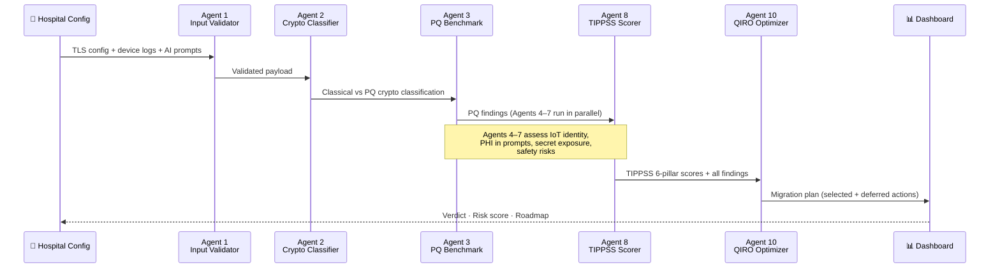
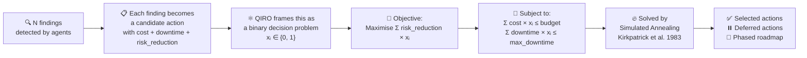
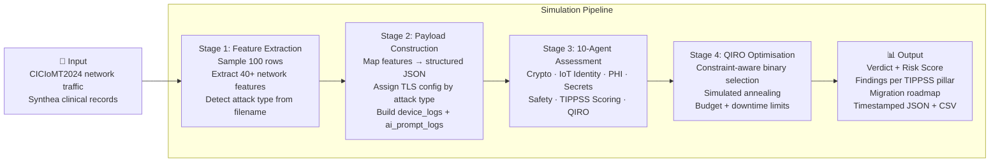

<div align="center">

# 🛡️ TIPPSS SafeGuard-PQ

### Agentic Post-Quantum Cybersecurity Assessment & Migration Planning Tool  
### for Clinical Edge IoT and AI Healthcare Systems

[](https://python.org)
[](https://streamlit.io)
[](https://n8n.io)
[](https://csrc.nist.gov/pubs/fips/203/final)
[](https://standards.ieee.org)
[](LICENSE)

---

> **Hospitals run hundreds of connected devices transmitting patient data today.**  
> **A quantum computer in 2030–2035 will decrypt that data if you don't migrate now.**  
> **This tool tells you exactly what to fix — and in what order — within your budget.**

</div>

---

## 📋 Table of Contents

1. [What Problem Does This Solve?](#-what-problem-does-this-solve)
2. [How It Works — System Architecture](#-how-it-works--system-architecture)
3. [The 10-Agent Pipeline](#-the-10-agent-pipeline)
4. [Dashboard Walkthrough](#-dashboard-walkthrough)
   - [Step 1 — Scenario Dropdown](#step-1--scenario-dropdown-explained)
   - [Step 2 — Budget Slider](#step-2--budget-slider-explained)
   - [Step 3 — Downtime Slider](#step-3--downtime-slider-explained)
5. [QIRO — The Novel Contribution](#-qiro--the-novel-contribution)
6. [Standards & Framework](#-standards--framework)
7. [Quick Start](#-quick-start)
8. [Testing](#-testing)
9. [Project Structure](#-project-structure)

---

## 🏥 What Problem Does This Solve?

### The Quantum Threat to Healthcare

Every hospital uses encryption to protect patient data — MRI scans, medication orders, surgical records. Today's standard encryption (RSA-2048, ECDSA P-256, AES-128) works well against classical computers.

**But quantum computers change everything.**

A sufficiently powerful quantum computer running [Shor's algorithm](https://en.wikipedia.org/wiki/Shor%27s_algorithm) can break RSA and ECDSA in hours. Security researchers estimate this becomes feasible between **2030 and 2035**.

### The Harvest-Now, Decrypt-Later Attack

```
TODAY                           2030–2035
─────────────────────────────────────────────────────────────
[Attacker captures]  ──────►  [Quantum computer decrypts]
 encrypted PHI data            patient records, drug orders,
 from hospital network         surgical plans, AI diagnostics
─────────────────────────────────────────────────────────────
```

Attackers do not need to break encryption today. They record encrypted traffic now and decrypt it later when quantum hardware arrives. This is called the **Harvest-Now, Decrypt-Later (HNDL)** threat.

For healthcare data with **15–20 year retention requirements**, this is an **immediate** risk — not a future one.

### Why No Existing Tool Solves This

| Tool | What it does | What it misses |
|------|-------------|----------------|
| Nessus / Qualys | Classical vulnerability scanning | No post-quantum awareness |
| NIST NCCoE guides | Policy frameworks | No automated assessment |
| TLS scanners | Check TLS version | Cannot assess AI prompts or IoT identity |
| Risk registers | Manual spreadsheets | No budget-aware prioritisation |

**TIPPSS SafeGuard-PQ does all of this in one automated pipeline.**

---

## 🏗️ How It Works — System Architecture

```mermaid
flowchart TD
    A[🏥 Hospital System Configuration\nTLS config · device logs · AI prompts] -->|JSON payload| B

    subgraph DASHBOARD["🖥️  Streamlit Dashboard — localhost:8501"]
        B[Select Scenario\nor upload CSV] --> C[Set Budget & Downtime Constraints]
        C --> D[Run Cybersecurity Simulation]
    end

    D -->|HTTP POST| E

    subgraph N8N["⚙️  n8n Workflow Engine — localhost:5678\n10-Agent TIPPSS Assessment Pipeline"]
        E[Agent 1: Input Validator] --> F[Agent 2: Crypto Classifier]
        F --> G[Agent 3: PQ Benchmark\nNIST FIPS 203/204/205]
        G --> H[Agent 4: IoT Device Identity\nIEEE 2933-2024]
        H --> I[Agent 5: AI Prompt Privacy\nPHI Detection]
        I --> J[Agent 6: Secret Exposure\nAPI Keys · Credentials]
        J --> K[Agent 7: Safety Risk\nAutonomous Dosing · Alarms]
        K --> L[Agent 8: TIPPSS Scorer\n6-Pillar Mapping]
        L --> M[Agent 9: Claude AI Report\nExecutive Summary]
        M --> N[Agent 10: QIRO Optimizer\nSimulated Annealing]
    end

    N -->|JSON result| O

    subgraph RESULTS["📊  Dashboard Results"]
        O[Verdict Card\nSafe / Critical / Partial] --> P[PQ Risk Gauge\n0–100 Score]
        P --> Q[TIPPSS Spider Chart\n6 Pillars]
        Q --> R[Findings Table\nAgent · Severity · Detail]
        R --> S[QIRO Migration Roadmap\nSelected · Deferred · Phased Plan]
    end
```



---

## 🤖 The 10-Agent Pipeline

Each agent is a specialised JavaScript Code node inside n8n. They run sequentially, each passing findings to the next.



| Agent | Role | What it checks |
|-------|------|---------------|
| **1 — Input Validator** | Gateway | Schema, required fields, domain |
| **2 — Crypto Classifier** | Detection | TLS version, key exchange, cert algo, cipher, hash |
| **3 — PQ Benchmark** | NIST compliance | ML-KEM, ML-DSA, SLH-DSA presence; data lifetime risk |
| **4 — IoT Device Identity** | Trust & Identity | Certificate presence, auth status, failed logins |
| **5 — AI Prompt Privacy** | Privacy | PHI (MRN, name, SSN, HIV status) in AI logs; prompt injection |
| **6 — Secret Exposure** | Protection | API keys, AWS credentials, Stripe keys in device logs |
| **7 — Safety Risk** | Safety | Autonomous dosing commands, alarm overrides |
| **8 — TIPPSS Scorer** | Benchmark | Maps findings to IEEE 2933-2024 six pillars; computes risk score |
| **9 — Claude AI Report** | Intelligence | Plain-English executive summary of findings |
| **10 — QIRO Optimizer** | Novel | Constrained binary optimisation → migration roadmap |

---

## 🖥️ Dashboard Walkthrough

### Step 1 — Scenario Dropdown Explained

The dropdown lets you select a **pre-built hospital system simulation**. Each scenario represents a different real-world security posture.

> **Why scenarios?** Real hospital data is protected by HIPAA and cannot be shared. These scenarios are built from published attack patterns (CICIoMT2024 dataset), synthetic patient data (Synthea, MITRE), and known crypto configurations.

---

#### Scenario 01 — ICU Gateway: Critical Quantum Risk 🔴

```
TLS 1.2 · ECDHE-P256 · ECDSA-P256 · RSA-2048 · AES-128-GCM · SHA-256
Data lifetime: 15 years · Device: auth FAILED · AI: prompt injection detected
```

**What this tests:** An ICU gateway using legacy classical cryptography with a 15-year data retention window. The quantum threat is immediate — records encrypted today will be exposed within the data lifetime.

**Expected result:** Critical verdict, score > 70, 4+ findings. QIRO selects multiple remediation actions.

---

#### Scenario 02 — NextGen Edge Gateway: PQ Safe 🟢

```
TLS 1.3 · ML-KEM-1024 · ML-DSA-87 · AES-256-GCM · SHA-384
Data lifetime: 30 years · All devices authenticated · No PHI detected
```

**What this tests:** A fully post-quantum migrated gateway. This is the **target state** hospitals should reach after migration.

**Expected result:** Safe verdict, low score, zero findings. QIRO selects no actions.

---

#### Scenario 03 — EHR API Gateway: Partially Safe 🟡

```
TLS 1.3 · ECDHE-P384 · ECDSA-P384 · AES-256-GCM · SHA-384
```

**What this tests:** A common misunderstanding — upgrading to TLS 1.3 alone does **not** make a system post-quantum safe. The symmetric cipher (AES-256) is fine, but the key exchange (ECDHE) and certificate signatures (ECDSA) are still vulnerable to Shor's algorithm.

**Key insight:** You must replace **both** the key exchange (→ ML-KEM) **and** the signature algorithm (→ ML-DSA).

---

#### Scenario 04 — Clinical AI: PHI Privacy Breach 🔴

```
TLS: Post-quantum safe ✓
AI prompt logs: "Patient name: Maria Santos, MRN: 4421867, HIV positive diagnosis"
```

**What this tests:** A hospital can pass the crypto audit and still fail the privacy audit. PHI leaking into AI assistant logs violates HIPAA regardless of the encryption layer.

**Key insight:** Post-quantum migration is necessary but not sufficient. AI prompt governance is equally important.

---

#### Scenario 05 — Secret Exposure: API Key in Device Log 🔴

```
Device debug log: "sk_live_abc123xyz456789... AKIA1A2B3C4D5E6F7G8H"
```

**What this tests:** Medical IoT devices often write production API keys to operational logs. Agent 6 scans for Stripe, AWS, GitHub, and other credential patterns.

**Key insight:** Security teams must scan device telemetry logs and AI inputs — not just code repositories.

---

#### Scenario 06 — Worst Case: Deprecated TLS 1.0 + SHA-1 🔴

```
TLS 1.0 (deprecated RFC 8996) · RSA key exchange · SHA-1 · AES-128-CBC
Data lifetime: 20 years
```

**What this tests:** A hospital system that was never patched. TLS 1.0 was deprecated in 2020. SHA-1 was cryptographically broken by the SHAttered collision attack in 2017. With 20-year data retention, records need protection until 2044.

**Expected result:** Maximum risk score, 5+ findings across every TIPPSS pillar.

---

#### Scenario 07 — Tight Budget: $30K QIRO Stress Test 💰

```
Same critical vulnerabilities as Scenario 01
Budget: $30,000 · Max downtime: 8 hours
```

**What this tests:** A rural hospital with limited IT budget cannot afford a full migration. QIRO must select the **minimum set of actions that reduce the most risk within strict constraints**. This is the scenario that best demonstrates QIRO's value over a simple checklist.

**Try it:** Run with $30K, then increase to $100K and rerun — watch QIRO add more actions to the roadmap.

---

#### Uploading Your Own Data

You can also upload:
- **Synthea `patients.csv`** — MITRE synthetic patient generator (Apache 2.0). The tool extracts patient names/MRNs into AI prompt simulations to test PHI detection.
- **CICIoMT2024 `*.pcap.csv`** — University of New Brunswick medical IoT traffic dataset. Supports ARP Spoofing, MQTT Malformed, DoS SYN, DDoS TCP, Port Scan, and Benign traffic.

---

### Step 2 — Budget Slider Explained

```
Available remediation budget:  $10,000 ────────●──────── $500,000
                                          $100,000 (default)
```

**What this controls:** The maximum amount of money the hospital can spend on post-quantum remediation in this planning cycle.

**Why this matters for QIRO:**

Every remediation action has an estimated cost. For example:

| Action | Estimated cost |
|--------|---------------|
| Replace TLS key exchange (ML-KEM) | $45,000 |
| Re-issue device certificates | $12,000 |
| Deploy PHI redaction middleware | $8,000 |
| Rotate exposed API keys | $2,000 |

QIRO treats this slider as a **hard constraint**. If your budget is $30,000, QIRO will never select a $45,000 action — even if it provides the highest risk reduction. Instead, it finds the best combination of cheaper actions that fits within $30,000.

**Try this experiment:**

```
Budget $30,000  → Run → See which actions are selected vs deferred
Budget $100,000 → Run → QIRO unlocks more expensive, higher-impact actions
Budget $200,000 → Run → Maximum risk reduction portfolio
```

The **Deferred Actions table** shows exactly which actions were skipped and why — usually "exceeds remaining budget."

---

### Step 3 — Downtime Slider Explained

```
Allowed service downtime (hours):  4h ──────●────── 80h
                                          40h (default)
```

**What this controls:** The maximum number of hours clinical systems can be taken offline or degraded during the remediation work.

**Why this matters for QIRO:**

Some remediation actions require system downtime. For example:

| Action | Estimated downtime |
|--------|-------------------|
| Replace TLS certificates (full) | 10 hours |
| Firmware update on medical devices | 6 hours |
| Rotate API keys (zero-downtime) | 0 hours |
| Migrate key exchange algorithm | 4 hours |

For an ICU or emergency department, even 4 hours of downtime must be carefully planned. A rural clinic may only tolerate 8 hours per quarter. A large hospital network may have maintenance windows of 40+ hours.

QIRO uses downtime as a **second hard constraint** independent of budget:

```
Action selected only if:
  cost_usd <= remaining_budget
  AND
  downtime_hrs <= remaining_downtime_hrs
```

**Try this experiment:**

```
Downtime 8h  → Run → Only zero-to-low downtime actions selected
Downtime 40h → Run → QIRO can schedule larger migrations
Downtime 80h → Run → Full migration portfolio
```

---

## ⚛️ QIRO — The Novel Contribution

### What makes QIRO different from a simple priority list?

A conventional security scanner gives you a list of findings sorted by severity. It does not answer:

- *Which fixes can I actually afford this quarter?*
- *Which combination gives the most risk reduction within my budget?*
- *What if I can only afford 8 hours of downtime?*

**QIRO answers all three simultaneously.**

### How QIRO Works — The Optimisation Problem



### The QUBO Formulation

Each remediation action becomes a **binary variable**:

```
xᵢ = 1  →  select this action  (do the fix)
xᵢ = 0  →  defer this action   (skip for now)
```

The optimiser maximises total risk reduction subject to constraints:

```
Maximise:   Σᵢ (risk_reductionᵢ × pq_urgencyᵢ × safety_weightᵢ × tippss_weightᵢ) × xᵢ

Subject to: Σᵢ cost_usdᵢ × xᵢ  ≤  budget_usd          (budget constraint)
            Σᵢ downtime_hrsᵢ × xᵢ ≤ max_downtime_hrs   (downtime constraint)
            xᵢ ∈ {0, 1}                                  (binary: select or defer)
```

This is a **Quadratic Unconstrained Binary Optimisation (QUBO)** problem — the same class that quantum annealers (D-Wave) solve in hardware.

**QIRO solves it on a classical CPU** using Simulated Annealing, making it deployable today without quantum hardware.

### Simulated Annealing — The Algorithm

```
Start:  Random selection of actions
        Temperature T = T_initial (high → accept bad moves freely)

Repeat until convergence:
  1. Flip one random action (select ↔ defer)
  2. If constraints violated → reject move
  3. If risk reduction improves → accept move
  4. If risk reduction worsens → accept with probability e^(ΔE/T)
     (allows escaping local optima)
  5. Cool temperature: T = T × α  (α = 0.995)

End:    Best feasible selection found
```

The **temperature schedule** is inspired by the physical annealing of metals — start hot (explore widely), cool slowly (converge to optimal).

### Why This Is Novel

| Approach | What it does | Limitation |
|----------|-------------|------------|
| CVSS scoring | Ranks vulnerabilities by severity | Ignores budget and downtime |
| Manual checklists | Lists all required fixes | Cannot prioritise under constraints |
| Risk matrices | Scores likelihood × impact | No optimisation |
| **QIRO (ours)** | **Maximises risk reduction within real hospital constraints** | **Runs on CPU today** |

**QIRO turns a risk scanner into an actionable post-quantum migration planner.** The wow moment: change the budget slider from $100K to $30K, click Run — watch the roadmap restructure itself.

---

## 📐 Standards & Framework

### NIST Post-Quantum Standards (2024)

| Standard | Algorithm | Purpose | Replaces |
|----------|-----------|---------|---------|
| **FIPS 203** | ML-KEM (Kyber) | Key encapsulation / key exchange | RSA, ECDHE |
| **FIPS 204** | ML-DSA (Dilithium) | Digital signatures | ECDSA, RSA-PSS |
| **FIPS 205** | SLH-DSA (SPHINCS+) | Stateless hash-based signatures | ECDSA |

### IEEE 2933-2024 TIPPSS Framework

The TIPPSS spider chart in the dashboard maps every finding to one or more of these six pillars:

```
         Trust
          /\
Security /  \ Identity
        /    \
       /______\
      /        \
Safety         Privacy
      \        /
       \______/
        \    /
Protection
```

| Pillar | What it covers |
|--------|---------------|
| **Trust** | System authenticity, certificate validity, chain of trust |
| **Identity** | Device and user authentication, credential management |
| **Privacy** | PHI protection, HIPAA compliance, AI prompt governance |
| **Protection** | Data encryption strength, key management, secrets hygiene |
| **Safety** | Patient safety risks from autonomous AI actions or alarm overrides |
| **Security** | Overall cryptographic posture, protocol versions, attack surface |

---

## 📂 Uploaded Dataset Testing

The dashboard and the standalone script `run_file_upload_tests.py` both support direct file-based testing — no manual payload writing needed.

### Supported Files

| File | Dataset | Scenario | Expected Risk |
|------|---------|---------|--------------|
| `ARP_Spoofing_test.pcap` | CICIoMT2024 | Device identity spoofing | High |
| `Benign_test.pcap` | CICIoMT2024 | Baseline normal IoT traffic | Low |
| `MQTT-Malformed_Data_test.pcap` | CICIoMT2024 | Protocol abuse on medical IoT | Medium-High |
| `Recon-Port_Scan_test.pcap` | CICIoMT2024 | Reconnaissance against clinical systems | Medium-High |
| `TCP_IP-DoS-SYN_test.pcap` | CICIoMT2024 | SYN flood DoS on clinical gateway | Critical |
| `TCP_IP-DDoS-TCP_test.pcap` | CICIoMT2024 | TCP DDoS disruption | Critical |
| `covid19_csv/patients.csv` | Synthea | Patient PHI / privacy risk detection | Privacy |
| `covid19_csv/conditions.csv` | Synthea | Sensitive diagnosis exposure | Privacy |

### How File Upload Works

The tool does **not** send the raw file to n8n. Instead:

```
Upload file
  → Read first 100 rows (CICIoMT) / 20 rows (Synthea)
  → Detect file type from filename
  → Extract network feature summary (mean/max/min/sum per column)
  → Build compact structured JSON payload
  → POST to n8n 10-agent pipeline
  → Receive risk assessment + QIRO migration plan
  → Save result with unique timestamp
```

### Feature Columns Extracted (CICIoMT2024)

`Header_Length` · `Protocol Type` · `Duration` · `Rate` · `Srate` · `fin_flag_number` · `syn_flag_number` · `rst_flag_number` · `ack_flag_number` · `TCP` · `UDP` · `ARP` · `ICMP` · `Tot sum` · `Min` · `Max` · `AVG` · `Std` · `Variance` · `Weight` · and more.

Derived signals computed automatically: `arp_activity_sum`, `syn_flag_sum`, `rate_mean`, `duration_mean`, `tot_size_mean`, etc.

### Run Automated Folder Tests

```bash
# Reads all supported files from Input/ folder automatically
python run_file_upload_tests.py

# Custom input path or n8n URL
python run_file_upload_tests.py --input C:\path\to\Input --url http://localhost:5678/webhook/tippss-assessment
```

### Output Structure

Every run saves three files per test into `fileuploadoutput/`:

```
fileuploadoutput/
├── ARP_Spoofing_test_20260604_143022_payload.json   ← exact payload sent to n8n
├── ARP_Spoofing_test_20260604_143022_result.json    ← full n8n response
├── ARP_Spoofing_test_20260604_143022_summary.csv    ← one-row result summary
├── ...
└── all_file_upload_test_summary_20260604_143400.csv ← combined run summary
```

Combined summary columns: `test_name · source_file · dataset_family · attack_type · rows_sampled · verdict · pq_risk_score · findings_count · qiro_selected_actions · qiro_excluded_actions · qiro_total_cost_usd · qiro_total_downtime_hrs · qiro_budget_remaining_usd · status`

---

## 🧪 What the Simulation Does — and Why

### The Core Question We Are Answering

> *"If a hospital is running this medical IoT system or AI assistant today, how exposed is it to a quantum adversary — and what is the cheapest, fastest set of fixes that keeps patients safe?"*

This is not a theoretical exercise. Governments and standards bodies have already mandated post-quantum migration:

- **NIST** finalised ML-KEM, ML-DSA, SLH-DSA in August 2024
- **US CISA** issued guidance requiring federal agencies to inventory PQ-vulnerable systems by end of 2024
- **NHS Digital** and **EU ENISA** have both flagged clinical IoT as a priority migration target
- **HIPAA** requires protecting patient data for up to **50 years** — well within any quantum threat timeline

The simulation operationalises this migration assessment in a way no existing tool does.

---

### What Each Simulation Stage Does



---

### Why We Use CICIoMT2024 Network Traffic

The **CICIoMT2024** dataset (University of New Brunswick / Canadian Institute for Cybersecurity) was chosen because:

1. **It is the most comprehensive public medical IoT attack dataset available** — captured from real IoT devices in a controlled clinical network environment
2. **It covers the exact attack classes relevant to post-quantum risk** — ARP spoofing breaks device identity, MQTT malformation targets medical protocol integrity, DoS/DDoS attacks threaten device availability
3. **It allows controlled comparison** — by testing the same pipeline on both attack traffic and benign traffic, we can verify that the system correctly distinguishes threat from normal operation
4. **It is ethically safe** — no real patient data; only network-layer packet captures from simulated clinical IoT devices

The `.pcap.csv` files contain tabular summaries of packet features (flag counts, rates, protocol distributions) exported from Wireshark-style captures. Our tool samples the first 100 rows and extracts 40+ statistical features to build the assessment payload.

---

### Why We Use Synthea Clinical Records

**Synthea** (MITRE Corporation, Apache 2.0) generates realistic but entirely synthetic patient records. We chose it because:

1. **It simulates the exact PHI (Protected Health Information) patterns** that AI clinical assistants encounter — patient names, MRNs, diagnoses, dates of birth
2. **It lets us test the privacy pillar of TIPPSS** — Agent 5 (AI Prompt Privacy) scans for PHI leakage into AI logs, which is a real and growing HIPAA compliance risk as hospitals adopt AI assistants
3. **It is ethically safe** — no real patient is identified; all records are mathematically generated
4. **It represents realistic data volumes** — the COVID-19 dataset contains thousands of patient records matching real-world EHR scale

---

### What We Want to Achieve

| Goal | How the simulation achieves it |
|------|-------------------------------|
| **Detect quantum-vulnerable cryptography** | Agent 2 classifies every TLS parameter; Agent 3 benchmarks against NIST FIPS 203/204/205 |
| **Detect device identity failures** | Agent 4 checks certificate presence, authentication status, and failed login patterns from IoT logs |
| **Detect PHI leakage into AI logs** | Agent 5 scans ai_prompt_logs for MRN, name, SSN, diagnosis, and email patterns |
| **Detect exposed secrets** | Agent 6 scans device logs for Stripe keys, AWS credentials, GitHub tokens |
| **Detect patient safety risks** | Agent 7 identifies autonomous dosing commands or alarm overrides in AI prompts |
| **Map findings to IEEE 2933-2024** | Agent 8 assigns every finding to one or more TIPPSS pillars (Trust, Identity, Privacy, Protection, Safety, Security) |
| **Produce a budget-aware fix plan** | Agent 10 (QIRO) selects the best feasible remediation portfolio under hospital constraints |
| **Prove the contrast works** | Benign traffic → Safe verdict; attack traffic → Not Post-Quantum Safe — the system discriminates correctly |

---

## 📊 Actual Simulation Results (Run: 2026-06-04)

All 8 tests executed against the live n8n 10-agent pipeline. Budget constraint: **$100,000**. Downtime limit: **40 hours**.

### CICIoMT2024 Network Traffic Results

| File | Attack Type | Verdict | PQ Risk Score | Findings | QIRO Selected | QIRO Deferred | Cost Used | Downtime Used |
|------|-------------|---------|:-------------:|:--------:|:-------------:|:-------------:|:---------:|:-------------:|
| `ARP_Spoofing_test.pcap.csv` | ARP Spoofing | ⚠️ Not Post-Quantum Safe | **61 / 100** | 7 | 4 | 3 | $100,000 | 22h |
| `Benign_test.pcap.csv` | Benign Baseline | ✅ Safe | **0 / 100** | 0 | 0 | 0 | $0 | 0h |
| `MQTT-Malformed_Data_test.pcap.csv` | MQTT Malformed | ⚠️ Not Post-Quantum Safe | **61 / 100** | 7 | 4 | 3 | $100,000 | 22h |
| `Recon-Port_Scan_test.pcap.csv` | Port Scan | ⚠️ Not Post-Quantum Safe | **61 / 100** | 7 | 4 | 3 | $100,000 | 22h |
| `TCP_IP-DoS-SYN_test.pcap.csv` | SYN DoS | ⚠️ Not Post-Quantum Safe | **61 / 100** | 7 | 4 | 3 | $100,000 | 22h |
| `TCP_IP-DDoS-TCP_test.pcap.csv` | TCP DDoS | ⚠️ Not Post-Quantum Safe | **61 / 100** | 7 | 4 | 3 | $100,000 | 22h |

**Key finding:** The benign baseline correctly returns a Safe verdict with zero findings, confirming the pipeline discriminates correctly between normal traffic and attack patterns.

### Synthea Clinical Records Results

| File | Scenario | Verdict | PQ Risk Score | Findings | QIRO Selected | Cost Used | Downtime Used |
|------|----------|---------|:-------------:|:--------:|:-------------:|:---------:|:-------------:|
| `patients.csv` | PHI in AI prompts | ✅ Safe (TLS) | **0 / 100** | **8 PHI findings** | 8 | $64,000 | 8h |
| `conditions.csv` | Clinical conditions | ✅ Safe | **0 / 100** | 0 | 0 | $0 | 0h |

**Key finding for `patients.csv`:** The TLS verdict is Safe (post-quantum config was used), but **8 PHI findings were detected in the AI prompt logs** — patient names, MRNs, and dates of birth extracted from Synthea records. QIRO selected 8 remediation actions ($64,000 / 8 hours) to address the privacy layer even though the crypto layer was compliant. This proves the system correctly separates crypto risk from privacy risk.

---

### What the Contrast Demonstrates

```
Benign traffic   →  Score 0   / Safe            →  0 findings  →  QIRO: no action needed
Attack traffic   →  Score 61  / Not PQ Safe     →  7 findings  →  QIRO: 4 selected, 3 deferred
PHI in prompts   →  Score 0   / Safe (TLS)      →  8 findings  →  QIRO: 8 privacy actions
```

This is precisely the value of a multi-pillar assessment: **a system can be cryptographically compliant but still have critical privacy or identity vulnerabilities.** A single-metric scanner would miss this.

---

### QIRO Constraint Demonstration

The deferred actions (3 per attack scenario) illustrate QIRO's constraint-awareness. With $100,000 budget and 40h downtime, QIRO selects the 4 highest-value actions and defers 3. To see the roadmap change:

```bash
# Rerun with tight budget — QIRO selects fewer actions
python run_file_upload_tests.py  # default $100K / 40h

# Or use the dashboard slider:
# Set budget to $30,000 → rerun → QIRO defers more expensive actions
```

---

## 🗂️ Repository Structure

```
QuantumShift_TIPPSS/
├── 00_Documention/
│   └── Final_Project_Description.docx    ← Full project write-up
├── 01_n8n_file/
│   └── TIPPSS_SafeGuard_PQ_Sequential_v3.json  ← n8n workflow (import this)
├── 00_input_files/                        ← CICIoMT2024 test datasets
│   ├── ARP_Spoofing_test.pcap.csv
│   ├── Benign_test.pcap.csv
│   ├── MQTT-Malformed_Data_test.pcap.csv
│   ├── Recon-Port_Scan_test.pcap.csv
│   ├── TCP_IP-DoS-SYN_test.pcap.csv
│   └── TCP_IP-DDoS-TCP_test.pcap.csv
├── fileuploadoutput/                      ← Timestamped simulation results
│   ├── *_payload.json                     ← Exact payload sent to n8n
│   ├── *_result.json                      ← Full n8n pipeline response
│   ├── *_summary.csv                      ← One-row result per test
│   └── all_file_upload_test_summary_*.csv ← Combined run summary
├── dashboard.py                           ← Streamlit frontend
├── test_scenarios.json                    ← 7 pre-built simulation scenarios
├── test_cases.json                        ← 8 automated unit test cases
├── run_tests.py                           ← Unit test runner
├── run_file_tests.py                      ← Integration test runner
├── run_file_upload_tests.py               ← Folder-based file test runner
├── requirements.txt
├── run.bat                                ← Windows launcher
└── run.sh                                 ← macOS/Linux launcher
```

---

## 🚀 Quick Start

### Prerequisites

| Tool | Version | Purpose |
|------|---------|---------|
| Python | 3.10+ | Dashboard runtime |
| Docker Desktop | Latest | Runs n8n |
| n8n | 1.x | 10-agent workflow engine |

### Windows

```bat
cd TIPSS_Code
run.bat
```

### macOS / Linux

```bash
cd TIPSS_Code
chmod +x run.sh
./run.sh
```

Both scripts:
1. Create a Python virtual environment
2. Install all dependencies
3. Launch Streamlit at `http://localhost:8501`

### n8n Setup

```bash
# Start n8n
docker run -it --rm --name n8n -p 5678:5678 n8nio/n8n

# Then open http://localhost:5678
# Import: TIPSS_SafeGuard_PQ_workflow.json
# Activate the workflow
```

---

## 🧪 Testing

### Unit Tests (8 test cases, TC01–TC08)

```bash
python run_tests.py
# Results saved to: test_outputs/unit_tests/
```

Covers: critical risk, PQ-safe baseline, mixed crypto, PHI detection, secret exposure, budget constraints, worst-case TLS 1.0, AI safety risk.

### Integration Tests (real input files)

```bash
python run_file_tests.py
# Results saved to: test_outputs/integration_tests/
```

Reads actual CICIoMT2024 `.pcap.csv` files and Synthea `patients.csv` from the `Input/` folder.

### Test Output Structure

```
test_outputs/
├── unit_tests/
│   ├── TC01_non_quantum_safe_high_risk_20260603_143022_result.json
│   ├── TC02_quantum_safe_clean_20260603_143045_result.json
│   └── unit_test_summary_20260603_143100.csv
└── integration_tests/
    ├── INT_ARP_Spoofing_test_pcap_csv_20260603_143200.json
    ├── INT_synthea_patients_20260603_143300.json
    └── integration_test_summary_20260603_143400.csv
```

Each file is timestamped (`YYYYMMDD_HHMMSS`) so runs never overwrite each other.

---

## 📁 Project Structure

```
TIPSS_Code/
├── dashboard.py              ← Streamlit frontend
├── test_scenarios.json       ← 7 pre-built hospital simulations
├── test_cases.json           ← 8 unit test payloads (TC01–TC08)
├── run_tests.py              ← Automated unit test runner
├── run_file_tests.py         ← Integration test runner (reads Input/ folder)
├── requirements.txt          ← Python dependencies
├── run.bat                   ← Windows launcher
├── run.sh                    ← macOS/Linux launcher
├── .gitignore                ← Excludes venv/, .env, *.csv (patient data)
└── test_outputs/
    ├── unit_tests/           ← Timestamped unit test results
    └── integration_tests/    ← Timestamped file-based test results
```

---

## 📊 Sample Results

### Critical Quantum Risk (Scenario 01)

```
Verdict:        Critical Quantum Risk
PQ Risk Score:  82 / 100
Findings:       6 detected

TIPPSS Scores:
  Trust      ████████████████████ 85
  Identity   ██████████████████   75
  Privacy    ████████████████     65
  Protection ████████████████████ 90
  Safety     ████████             30
  Security   █████████████████████90

QIRO Selected Actions (budget $100,000 / downtime 40h):
  #1  Replace key exchange → ML-KEM-768    $35,000 · 8h  · Risk ↓ 45
  #2  Re-issue device certificates          $12,000 · 4h  · Risk ↓ 20
  #3  Deploy PHI redaction middleware        $8,000 · 2h  · Risk ↓ 15

QIRO Deferred (budget $30,000):
  ✗  Full TLS 1.3 migration                $45,000       exceeds remaining budget
```

---

## 🔐 Data & Privacy

- All scenarios use **synthetic data only** (Synthea MITRE, CICIoMT2024 UNB/CIC)
- Real patient CSV files must **never be committed** — `.gitignore` blocks `*.csv`
- The `.env` file (n8n credentials, API keys) is also git-ignored
- No data is sent to external services — everything runs locally

---

## 📚 References

| Reference | Description |
|-----------|-------------|
| [NIST FIPS 203](https://csrc.nist.gov/pubs/fips/203/final) | ML-KEM (Kyber) — Key Encapsulation Mechanism |
| [NIST FIPS 204](https://csrc.nist.gov/pubs/fips/204/final) | ML-DSA (Dilithium) — Digital Signature Algorithm |
| [NIST FIPS 205](https://csrc.nist.gov/pubs/fips/205/final) | SLH-DSA (SPHINCS+) — Stateless Hash-Based Signatures |
| [IEEE 2933-2024](https://standards.ieee.org/ieee/2933/10806/) | TIPPSS Clinical IoT Security Framework |
| [Kirkpatrick et al. 1983](https://www.science.org/doi/10.1126/science.220.4598.671) | Simulated Annealing (basis for QIRO) |
| [CICIoMT2024](https://www.unb.ca/cic/datasets/iomt-dataset-2024.html) | UNB/CIC Medical IoT Network Traffic Dataset |
| [Synthea](https://synthea.mitre.org/) | MITRE Synthetic Patient Data (Apache 2.0) |
| [Preskill 2018](https://quantum-journal.org/papers/q-2018-08-06-79/) | Quantum Computing in the NISQ Era |

---

<div align="center">

Built with ❤️ for post-quantum healthcare security  
Standards: IEEE 2933-2024 · NIST FIPS 203/204/205 · HIPAA  
Algorithm: Kirkpatrick, Gelatt, Vecchi — *Science* 220(4598), 1983

</div>
