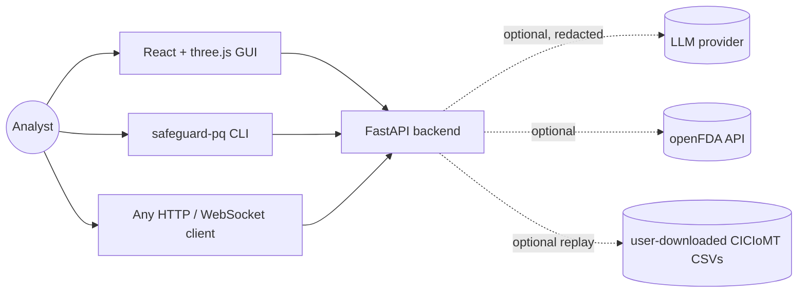

# Architecture

## System context

A user (security researcher, analyst or student) supplies a description of a system — crypto configuration, device logs,
AI prompt logs and/or traffic features — directly, through a CSV upload, or by selecting a device in the built-in fleet
simulator. The backend runs a multi-agent assessment and returns a verdict, explanations, a remediation plan and a PDF.
Optional outbound integrations (an LLM provider and the public openFDA API) are disabled by default.

## Major components

| Component | Package / folder | Responsibility |
|---|---|---|
| API | `safeguard_pq.api` | REST + WebSocket routes, app factory, in-memory stores |
| Orchestrator | `safeguard_pq.orchestrator` | Runs agents stage by stage (parallel within a stage), merges findings deterministically, emits events, assembles the result |
| Agents | `safeguard_pq.agents` | 14 single-responsibility agents (see below) |
| Tool registry | `safeguard_pq.tools` | Pure, schema-described evidence functions used by agents; also exposed over HTTP |
| Knowledge base | `safeguard_pq.knowledge` | PQ catalogue, detection rules, traffic rules, remediation templates, redaction |
| Optimizer | `safeguard_pq.optimizer.qiro` | QIRO constrained remediation selection |
| Simulator | `safeguard_pq.simulation` | Fleet templates, device profiles, attacks, mitigations, telemetry, fleet assessment |
| Ingest | `safeguard_pq.ingest` | CSV → assessment request (CICIoMT-format flows, Synthea) |
| Reporting | `safeguard_pq.reporting` | PDF reports (ReportLab) |
| LLM adapter | `safeguard_pq.llm` | Optional narrative generation over plain HTTP |
| Frontend | `frontend/` | React + TypeScript + three.js (React Three Fiber) |

## Component responsibilities — agents

| Stage | Agent | Reads | Produces | Tools |
|---|---|---|---|---|
| 1 | Intake & Validation | request | normalised prompts/devices, detected input types | — |
| 2 | Crypto Inventory | `tls_config` | inventory, crypto findings | `pqc.classify_algorithm` |
| 3 | Post-Quantum Identification | `tls_config`, crypto findings, assumptions | PQ migration findings, HNDL finding, PQ posture | `pqc.classify_algorithm`, `pqc.mosca_inequality` |
| 4 ∥ | Clinical Privacy (PHI) | prompts | PHI findings | `privacy.scan_phi` |
| 4 ∥ | Device Identity | device logs | identity findings | — |
| 4 ∥ | Prompt Injection & PQ-Downgrade | prompts | injection findings | `security.scan_prompt_injection` |
| 4 ∥ | Secret Exposure | device logs, prompts | secret findings | `security.scan_secrets` |
| 4 ∥ | Clinical Safety | prompts | unsafe-instruction findings | `safety.scan_unsafe_instructions` |
| 4 ∥ | Network Traffic Anomaly | `iot_traffic` | traffic findings | `traffic.analyze_features` |
| 5 | TIPPSS Mapping | findings | pillar scores | `standards.tippss_pillars` |
| 6 | PQ Risk Scoring | findings, posture | score, verdict, environment status | — |
| 7 | QIRO Remediation Planner | findings, constraints | plan | `remediation.lookup` |
| 8 | Explainability (XAI) | everything above | attributions, counterfactuals, projection | — |
| 9 | Report Writer | everything above | narrative (template or LLM) | — |

## Data flow

1. A request (`AssessmentRequest`) arrives via REST, WebSocket, CLI or the simulator (`Simulation.to_request`).
2. The orchestrator creates a `RunContext` (request copy, seed, artifacts, findings).
3. Each agent gets an `AgentRecorder` that records notes, tool calls and staged findings and emits live events.
4. After each stage, staged findings are appended in declared agent order and receive ids `F1…Fn`.
5. Later agents read artifacts (`pq_posture`, `tippss`, `scoring`, `qiro`, `explanation`).
6. The orchestrator assembles an `AssessmentResult` (also stored in an in-memory LRU store for PDF download).

## Model / algorithm flow

Detection is rule-based (regular expressions, catalogue lookups, threshold rules). Scoring is additive with fixed
weights. Planning uses QIRO (see [methodology.md](methodology.md)). No trained ML model is shipped. The optional LLM never
influences findings, scores or plans.

## Interfaces

- REST: `/api/v1/health`, `/agents`, `/tools`, `/tools/{name}`, `/knowledge`, `/scenarios[/{id}]`, `/assessments[/{id}]`,
  `/assessments/{id}/report.pdf`, `/uploads/assess`, `/simulations/*`. OpenAPI at `/docs`.
- WebSocket: `/api/v1/ws/assessments` (agent events), `/api/v1/simulations/{id}/stream` (telemetry ticks).
- CLI: `safeguard-pq serve | scenarios | assess`.

Event types on the assessment stream: `run_started`, `stage_started`, `agent_started`, `agent_note`, `tool_called`,
`finding`, `agent_completed`, `run_completed`, then a final `result` (or `error`).

## Storage

None persistent. Assessments (LRU, default 200), simulations (20) and fleet reports live in process memory and are lost on
restart. Uploaded files are parsed in memory and discarded.

## Dependencies

Backend: FastAPI, Uvicorn, Pydantic (+ settings), httpx, python-multipart, ReportLab. Frontend: React, three.js,
@react-three/fiber, @react-three/drei, Vite, TypeScript; Playwright for E2E tests. All are permissively licensed
(MIT / BSD / Apache-2.0); see the respective package metadata.

## Deployment / execution model

Single-process Uvicorn server plus a static or dev-served frontend; intended for local or lab use. The Vite dev/preview
server proxies `/api` (including WebSockets) to the backend.

## Design decisions

- **Rule-based agents first.** Determinism and auditability matter more than raw detection power for a prototype whose
  claims must be checkable. ML detectors can be added later as additional agents and compared against this baseline.
- **Tools as the evidence boundary.** Agents only learn about inputs through registered tools, which makes every piece of
  evidence attributable and lets external agents (or an LLM tool-calling loop) reuse exactly the same functions.
- **Deterministic merge order** for concurrently running agents so identifiers and plans are reproducible.
- **LLM optional and downstream.** Prevents non-determinism and hallucinations from affecting the verdict; inputs are redacted.
- **Parity with v0.** The port keeps the prototype's constants so earlier results remain comparable; deliberate
  corrections are documented in the CHANGELOG.

## Known architectural limitations

In-memory state, no authentication, single process; configuration must be supplied (no active scanning); the simulator is
a discrete-time abstraction, not a network emulator.
